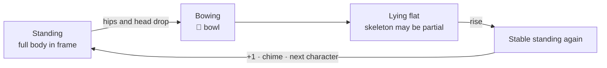

<div align="center">

[简体中文](README.md) | English


# Guiyuan Yoga Counter

**Prop your phone up in front of your mat. You practise — it counts.**

A free web app that uses your phone's front camera to count Guiyuan Yoga movements automatically. Optionally, each repetition reveals the next character of the *Tao Te Ching*.<br/>
Runs in the browser · nothing to install · no sign-up · video never leaves your phone

[](https://freefov-maxwell.github.io/prostration-counter/)

[](LICENSE)


<br/>


</div>

> **Note:** the app interface and voice prompts are currently in **Chinese only**. Counting works the same for everyone, and translations are welcome. See [Contributing](#-contributing).

---

Guiyuan Yoga practice reference: [Shi Zhao Qi Ming Tang's membership page](https://shizhao.org.cn/membership). This tool provides automatic counting, session history, and optional text display.

## Why

Counting repeated full-body movements can interrupt concentration. This app helps you track each session and your progress over time:

- 🧮 **Counting in your head breaks concentration**, and it's easy to lose track.
- 🔢 **Handheld tally counters need a free hand**, and you don't have one when you're flat on the floor.
- 📅 **Long commitments need records.** Without them you can't see how far you've come.

This app fixes that. Stand your phone up in front of you, and every time you return to standing it adds **+1**. You don't press anything.

## ✨ Features

| | |
|---|---|
| 🔢 **Automatic counting** | Detects the full cycle (standing → bending down → lying flat → rising) and adds +1 once you're standing again |
| 🔔 **Audio cues, so you don't watch the screen** | A low tone when it detects you going down, a chime for each completed repetition, and a separate cue when you reach your goal |
| 🗣️ **Voice positioning guide** | Spoken prompts such as "step back, your head is out of frame" help you get into position, followed by a 5-second countdown before counting starts |
| ⏸️ **Auto-pause** | Walk out of frame (to answer the phone, say) and counting pauses. Step back in and it carries on |
| 📊 **Stats and streaks** | Today's count, day streak, total count and time, 7- and 30-day charts, and a log of every session |
| 📜 **One character per repetition (optional)** | Off by default. Turn it on and the full *Tao Te Ching* (5,277 characters) advances one character with each repetition, with progress kept across days |
| 🔒 **Private by design** | Pose detection runs entirely on your phone. **No video is uploaded or recorded**, and your data stays on your device. No account, no ads |
| 📶 **Works offline** | The first visit downloads a ~16 MB detection model. After that it works without a connection, and you can add it to your home screen like an app |

## 📱 Screenshots

<table>
  <tr>
    <td align="center"><br/><sub>Home: today's count and streak</sub></td>
    <td align="center"><br/><sub>Prepare: phone placement and goal</sub></td>
    <td align="center"><br/><sub>Summary: count, time and pace</sub></td>
    <td align="center"><br/><sub>Stats: totals and history</sub></td>
  </tr>
</table>

## 🚀 Get started

<table>
  <tr>
    <td width="200" align="center">
      <br/>
      <sub>Scan with your phone</sub>
    </td>
    <td>
      <b>1. Open the app</b><br/>
      In your phone's browser, go to <a href="https://freefov-maxwell.github.io/prostration-counter/">freefov-maxwell.github.io/prostration-counter</a>.<br/>
      Safari on iPhone and Chrome on Android work best.<br/><br/>
      <b>2. Add it to your home screen (recommended)</b><br/>
      iPhone: Safari's Share button → "Add to Home Screen"<br/>
      Android: Chrome menu → "Add to Home screen" / "Install app"
    </td>
  </tr>
</table>

### A full session

1. **Place your phone.** Stand it upright with the screen facing you, bottom on the floor and tilted slightly back (leaning it on a cup or a book is fine). Put it **about 10–20 cm beyond your fingertips** when you're lying flat with your arms stretched out.
2. **Tap 开始练习 (Start), then 开始**, and allow camera access. To read along, switch on 显示《道德经》逐字 (*Show Tao Te Ching*) on the prepare page.
3. **Step back and stand still.** Your whole body should be in frame, standing straight with your arms relaxed at your sides. Voice prompts help you adjust, and counting starts after a **5-second countdown**.
4. **Practise.** The 🔔 low tone means a bow has been detected. Stand back up and the chime means **+1**.
5. **Finish.** Tap 结束 (End) to save the session. Your totals and streak update automatically.

> 💡 **Tips**
> - Good lighting, a plain background and close-fitting clothes improve detection.
> - Missed one, or counted one too many? Use the on-screen **+1 / −1** buttons, or reset to zero.
> - You can set a goal, such as **108** or a custom number, and you'll hear a cue when you reach it.
> - Keep the page in the foreground. If you switch apps or lock the screen, the system stops the camera. You can resume when you come back.

## ❓ FAQ

<details>
<summary><b>Is my video uploaded anywhere?</b></summary>

No. The app is a purely client-side web page with no backend. Camera frames are only processed in your phone's browser memory. They're never recorded, stored or sent anywhere. Your session history lives in the browser's local storage (IndexedDB), and you can export a JSON backup from Settings.
</details>

<details>
<summary><b>The camera won't open, or it says my device isn't supported.</b></summary>

- Make sure camera permission is granted.
- Recommended: Safari on iOS 16.4+, or a recent Chrome on Android.
- Browsers built into other apps can be limited. Open the link in your system browser instead.
</details>

<details>
<summary><b>The count is off. What can I do?</b></summary>

Usually it's the phone's position. Your whole body must be in frame while you're standing, because standing is what the count is anchored to. It's normal for the camera to see only part of you while you're lying close to the phone. For an occasional miss, use +1 / −1.
</details>

## 🧠 How it works

Each camera frame goes to the lightweight Google [MoveNet](https://www.tensorflow.org/hub/tutorials/movenet) model (switchable in Settings to the steadier but heavier [MediaPipe](https://developers.google.com/mediapipe) BlazePose), which finds body landmarks on the device. A rule-based state machine then follows the movement:



The count is anchored to **returning to a stable standing position**, where the whole body is visible and detection is most reliable. While you're on the floor, several signals together infer what's happening, so a complete skeleton isn't needed on every frame. There's no cloud and no trained classifier.

## 🗺️ Roadmap

- [x] Automatic counting and manual correction
- [x] *Tao Te Ching* character-by-character display with progress across days
- [x] Voice positioning guide, bowl and chime cues
- [x] History, streaks, data export
- [x] Offline PWA
- [ ] English (and other) UI translations
- [ ] WeChat Mini Program version
- [ ] More texts and custom text
- [ ] Sync across devices

## 🤝 Contributing

- Find it useful? A ⭐ **Star**, or sharing it with others who might find it useful, helps a lot.
- Detection problems or device issues? Please open an [issue](https://github.com/freefov-maxwell/prostration-counter/issues). Your phone model and how you placed it help a lot.
- PRs are very welcome, especially **UI translations**, new texts and detection improvements.

<details>
<summary><b>Local development</b></summary>

Stack: React 18 + TypeScript + Vite + TensorFlow.js (MoveNet) / MediaPipe Tasks Vision, a fully client-side PWA.

```bash
npm install     # also copies the MediaPipe WASM assets
npm run dev     # dev server
npm test        # unit tests
npm run build   # production build (outputs dist/)
```

The camera needs a secure context (`localhost` or HTTPS). To test on a real phone, the easiest way is `npx cloudflared tunnel --url http://localhost:5173`, which gives you an HTTPS URL. Pushes to `main` deploy to GitHub Pages automatically through GitHub Actions.

For Cloudflare Workers, set the project root to the directory containing `package.json` and `wrangler.jsonc`, the build command to `npm run build`, and the deploy command to `npx wrangler deploy --config wrangler.jsonc`. Commit `wrangler.jsonc` with the project: it points directly to the static `dist/` directory, avoiding automatic configuration that does not support Vite 5. No Vite upgrade or Cloudflare Vite plugin is needed.

The default build uses `/` for Cloudflare. The GitHub Pages workflow uses `npm run build -- --base=/prostration-counter/` for its subdirectory; the PWA start URL and scope follow the build base automatically.
</details>

## License

[MIT](LICENSE) © freefov-maxwell

The pose detection models and runtimes come from Google MoveNet / TensorFlow.js and MediaPipe (both Apache-2.0). The *Tao Te Ching* text is in the public domain.

---

[时照启明堂](https://shizhao.org.cn/)
