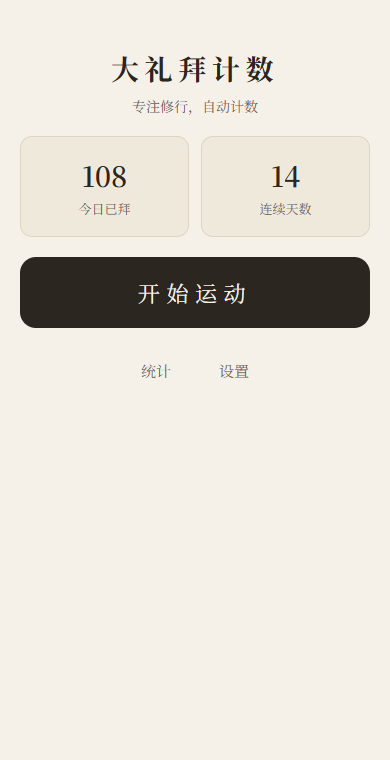
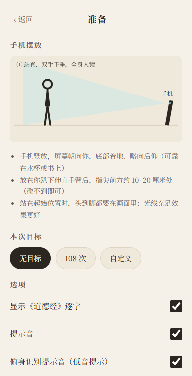
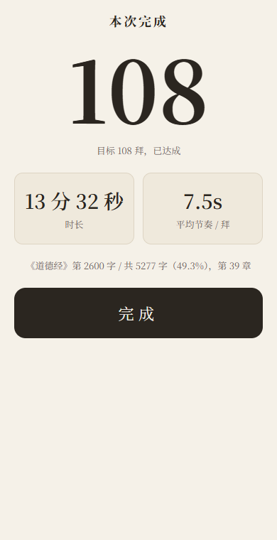
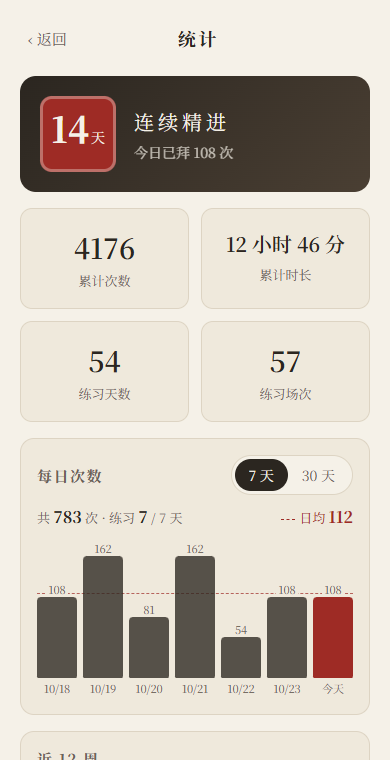
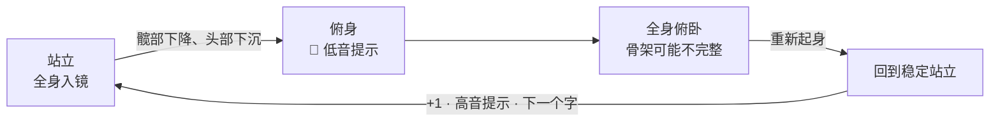

<div align="center">

简体中文 | [English](README.en.md)


# 归元瑜伽计数 · Guiyuan Yoga Counter

**把手机立在垫子前，你只管练习，它来数。**

用手机前置摄像头自动为归元瑜伽计数；还可开启「每次一字」，边练习边读《道德经》。<br/>
打开网页即用 · 无需下载 App · 不注册 · 视频不出手机

[](https://freefov-maxwell.github.io/prostration-counter/)

[](LICENSE)


<br/>



</div>

---

归元瑜伽练习来源参考[时照启明堂会员页](https://shizhao.org.cn/membership)，本工具提供自动计数、练习记录与可选的文字显示。

## 为什么做这个

做归元瑜伽练习的人大多有过这些烦恼：

- 🧮 **边练习边数容易分心**，数着数着就乱了，打断专注；
- 🔢 **手持计数器要手持或额外按一下**，全身俯卧时根本腾不出手；
- 📅 **长期累计练习**，没有记录就看不到自己走了多远。

于是有了这个小工具：**手机立在面前，摄像头看着你，起身那一刻自动 +1。** 你什么都不用按。

## ✨ 亮点

| | |
|---|---|
| 🔢 **自动计数** | 识别"站立 → 俯身 → 全身俯卧 → 起身"完整一次动作，回到站立时自动 +1 |
| 📜 **每次一字（可选）** | 默认只计数；在准备页或设置中开启后，内置《道德经》全文 5327 字随动作推进，每次一个字，进度跨天累计，练习结束，阅读进度也会保存 |
| 🔔 **声音反馈，不用盯屏幕** | 识别到俯身时一声低音提示，完成一次动作一声高音提示，达成目标另有提示 |
| 🗣️ **语音站位引导** | "头部出画了，请后退一步""离得太远了，请靠近一点"……按提示站好，倒数 5 秒自动开始 |
| ⏸️ **离开自动暂停** | 中途接电话、开门，人一走出画面就暂停，回来站好自动继续 |
| 📊 **统计与坚持** | 今日次数、连续天数、累计次数与时长、近 7 / 30 天柱状图、每次的历史记录 |
| 🔒 **隐私到底** | 姿态识别全部在手机本地完成，**视频不上传、不录制**；数据只存在你的手机里，无账号、无埋点、无广告 |
| 📶 **离线可用** | 首次打开下载约 4 MB 识别模型，之后断网也能用；可"添加到主屏幕"，像 App 一样打开 |

## 📱 截图

<table>
  <tr>
    <td align="center"><br/><sub>主页：今日次数与连续天数</sub></td>
    <td align="center"><br/><sub>准备：手机摆放示意、目标设置</sub></td>
    <td align="center"><br/><sub>完成：本次次数、时长、节奏</sub></td>
    <td align="center"><br/><sub>统计：连续天数、每日趋势与历史记录</sub></td>
  </tr>
</table>

## 🚀 立即开始

<table>
  <tr>
    <td width="200" align="center">
      <br/>
      <sub>手机扫码打开</sub>
    </td>
    <td>
      <b>① 打开网页</b><br/>
      手机浏览器访问 <a href="https://freefov-maxwell.github.io/prostration-counter/">freefov-maxwell.github.io/prostration-counter</a><br/>
      推荐 iPhone 用 Safari、安卓用 Chrome；微信内打开如无法使用摄像头，请点右上角"在浏览器中打开"。<br/><br/>
      <b>② 添加到主屏幕（推荐）</b><br/>
      iPhone：Safari 底部「分享」→「添加到主屏幕」<br/>
      安卓：Chrome 菜单 →「添加到主屏幕 / 安装应用」
    </td>
  </tr>
</table>

### 一次完整的练习

1. **摆好手机** —— 手机竖放、屏幕朝向你，底部着地、略向后仰（靠在水杯或书上就行），放在你**趴下伸直手臂后指尖前方约 10–20 厘米**的地方。
2. **点「开始练习」→「开始」**，允许使用摄像头（想边练习边阅读，在准备页打开「显示《道德经》逐字」）。首次使用会下载识别模型（约 4 MB），之后离线可用。
3. **后退站好** —— 站在起始位置，头到脚都在画面里，站直、双手自然下垂。语音会提示你前后调整，就位后**倒数 5 秒**开始计数。
4. **开始练习** —— 听到 🔔 低音提示声表示"已识别到俯身"，起身站稳听到高音提示声就是 **+1**。抬头就能看到数字（开启文本时还有下一个字）。
5. **结束** —— 点「结束」保存本次记录，累计数、连续天数自动更新。

> 💡 **小贴士**
> - 光线充足、背景简洁、衣着不过于宽大，识别更稳定。
> - 偶尔漏计或多计？屏幕上有 **+1 / −1** 按钮随时手动修正，也可以一键清零。
> - 可以设定目标（如 **108 次** 或自定义），达成时会有提示。
> - 练习过程中请保持页面在前台；切到后台或锁屏后摄像头会被系统停止，回来时可选择继续。

## ❓ 常见问题

<details>
<summary><b>我的视频会被上传吗？</b></summary>

不会。整个应用是纯前端网页，没有后端服务器。摄像头画面只在你手机的浏览器内存里交给姿态识别模型处理，不录制、不保存、不上传。练习记录保存在浏览器本地（IndexedDB），设置页可导出 JSON 备份。
</details>

<details>
<summary><b>摄像头打不开 / 提示不支持？</b></summary>

- 请确认已允许浏览器使用摄像头；
- 推荐系统版本：iOS 16.4+ 的 Safari、较新的安卓 Chrome；
- 部分 App 内置浏览器（如微信）对摄像头支持有限，请改用系统浏览器打开。
</details>

<details>
<summary><b>计数不准怎么办？</b></summary>

最常见的原因是摆放位置：站立时全身必须在画面里（站立是计数的"锚点"）。趴下时离手机很近、拍不全没关系，这是设计内的正常情况。若仍偶有误差，可用 +1 / −1 手动修正。
</details>

<details>
<summary><b>换手机或清理浏览器数据后记录还在吗？</b></summary>

数据只存在当前浏览器里。清理浏览器数据会清空记录，建议定期在「设置 → 导出数据」备份。
</details>

<details>
<summary><b>能读其他文本吗？</b></summary>

目前内置《道德经》，默认关闭，可在准备页或设置里开启；设置里还能查看进度、跳转到任意字或重置。更多文本在路线图里，欢迎提 Issue 告诉我们你想要哪一部。
</details>

## 🧠 它是怎么数的

摄像头每一帧交给轻量的 Google [MoveNet](https://www.tensorflow.org/hub/tutorials/movenet) 模型（设置里可切换为更稳但更重的 [MediaPipe](https://developers.google.com/mediapipe) BlazePose），在手机本地识别人体关键点；再由一个规则状态机判断动作阶段：



计数锚定在"回到稳定站立"这一刻——站着时全身可见、识别最可靠；俯地阶段即使人离手机太近拍不全，也能靠多个信号推断，不要求每帧都有完整骨架。整套逻辑不依赖云端，也不需要训练数据。

## 🗺️ 路线图

- [x] 自动计数 + 手动修正
- [x] 《道德经》逐字显示与跨天进度
- [x] 语音站位引导、低音提示 / 高音提示反馈
- [x] 历史统计、连续天数、数据导出
- [x] PWA 离线可用
- [ ] 微信小程序版
- [ ] 更多文本及自定义文本
- [ ] 多设备数据同步

## 🤝 参与 & 支持

- 觉得有用？点一个 ⭐ **Star**，或者把链接转给练习伙伴，就是最大的支持。
- 遇到识别不准、机型不兼容，欢迎在 [Issues](https://github.com/freefov-maxwell/prostration-counter/issues) 反馈（附上手机型号和摆放方式会很有帮助）。
- 欢迎 PR：新增文本、界面翻译、识别算法改进都很需要。

<details>
<summary><b>本地开发（开发者）</b></summary>

技术栈：React 18 + TypeScript + Vite + TensorFlow.js（MoveNet）/ MediaPipe Tasks Vision，纯前端 PWA。

```bash
npm install     # 会自动复制 MediaPipe WASM 资源
npm run dev     # 开发服务器
npm test        # 单元测试
npm run build   # 生产构建（输出 dist/）
```

摄像头需要安全上下文（`localhost` 或 HTTPS）。用手机真机调试时，最简单的办法是 `npx cloudflared tunnel --url http://localhost:5173` 拿到一个 HTTPS 地址。推送到 `main` 分支会通过 GitHub Actions 自动部署到 GitHub Pages。

Cloudflare Workers 部署：项目根目录设为包含 `package.json` 和 `wrangler.jsonc` 的目录，构建命令为 `npm run build`，部署命令为 `npx wrangler deploy --config wrangler.jsonc`。务必将 `wrangler.jsonc` 一并提交；它直接指定静态资源目录 `dist/`，避免触发不支持 Vite 5 的自动配置流程，无需升级 Vite 或安装 Cloudflare Vite 插件。

默认构建使用根路径 `/`，适用于 Cloudflare。GitHub Pages 工作流通过 `npm run build -- --base=/prostration-counter/` 指定子路径；PWA 的启动地址和作用域会随构建路径自动生成。
</details>

## 许可证

[MIT](LICENSE) © freefov-maxwell

姿态识别模型与运行时来自 Google MoveNet / TensorFlow.js 与 MediaPipe（均为 Apache-2.0）；《道德经》文本属公有领域。

---

[时照启明堂](https://shizhao.org.cn/)
